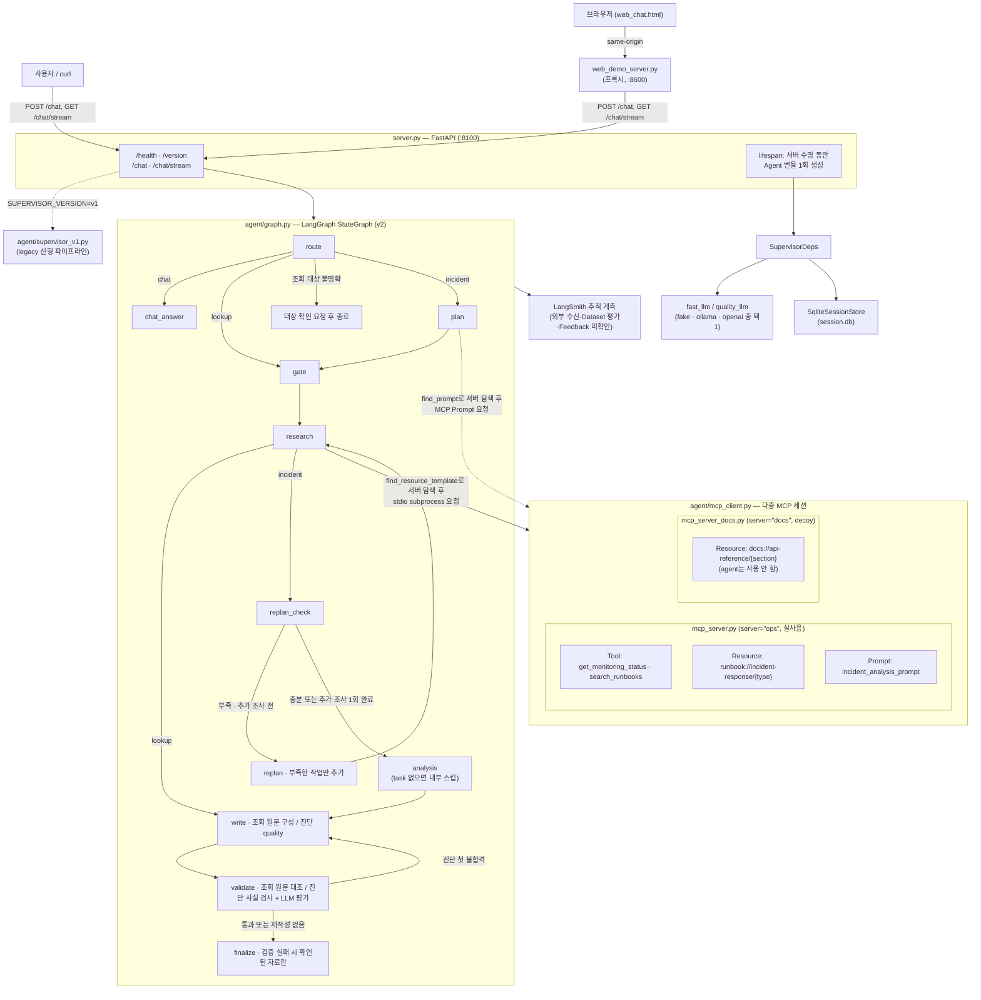
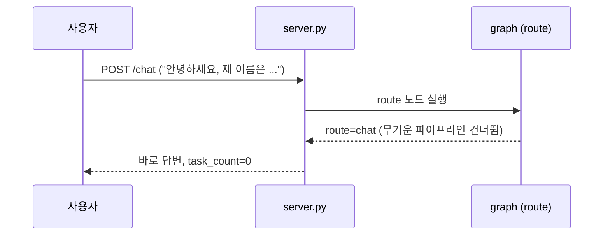
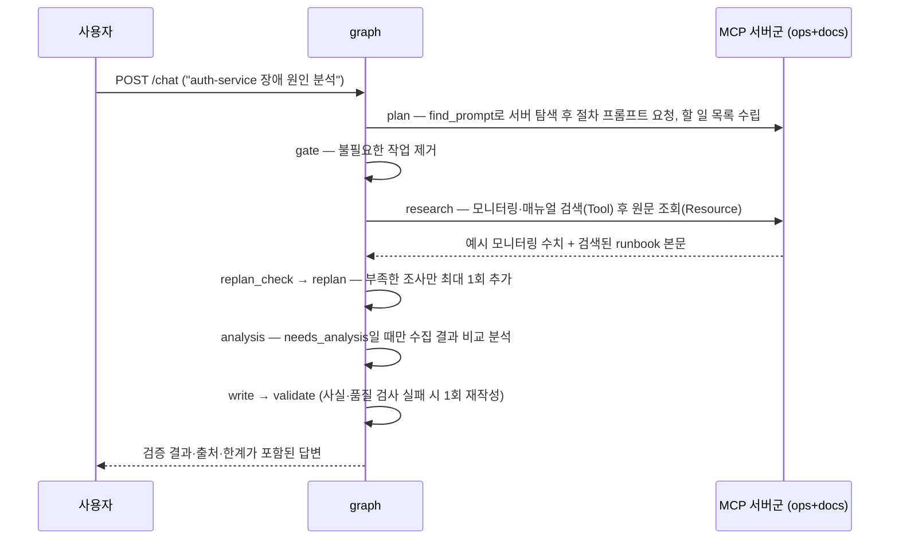
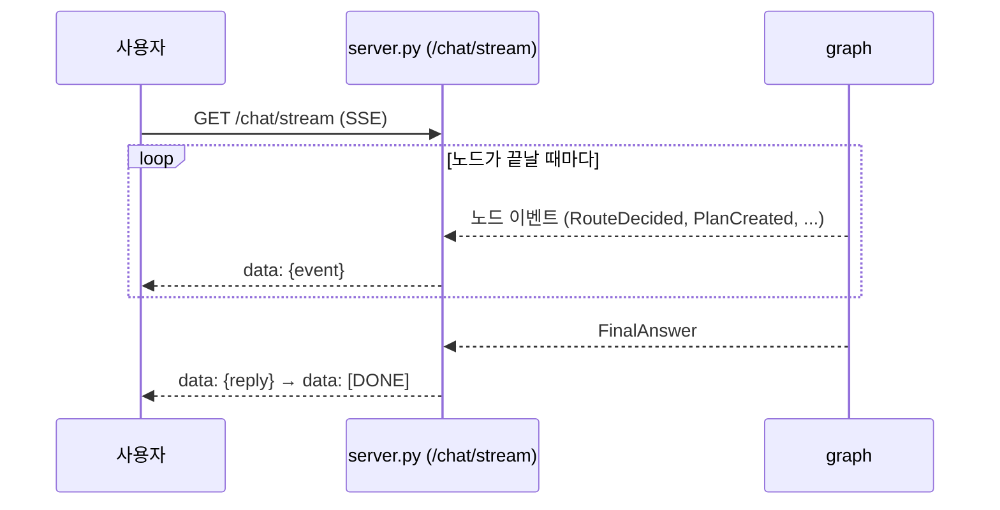
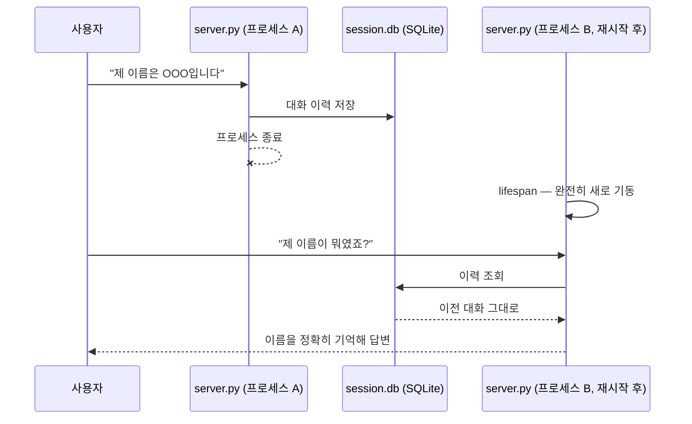
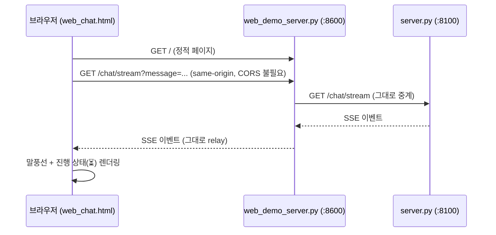

# Ops Desk 상세 설계와 동작

수업에서 제공한 Vue 3 운영 지원 서비스를 바탕으로 요청 분류·작업 검증·매뉴얼 검색·
추가 조사·답변 검증을 확장한 버전이다. 브라우저 채팅 화면은 Vue 3 CDN을 사용하며
별도 프론트엔드 빌드가 필요 없다.

조회 답변의 처리 방식과 실제 모델 15개 질문 재평가 결과는 [조회 답변 개선 평가](../evaluation/ANSWER-QUALITY.md)에 정리했다.

Wave 1~15가 각각 증명한 패턴(싱글턴·MCP·SSE·라우팅·게이트·재계획·검증·재시도·병렬·비용분리·
세션·주입·버전 토글·가드)을 전부 조립한 **실제 동작하는 에이전트 서비스**다. LLM 자리는
`fake`(결정론)/`ollama`(로컬 실모델)/`openai`(실제 API) 세 백엔드 중 아무거나 꽂을 수 있고,
노드·LLM·MCP 호출에는 LangSmith 추적 코드가 있다. 외부 추적 수신과 Dataset 평가·Feedback
등록은 이번 통합 점검에서 확인하지 않았다. 로컬 비교 평가는 `evaluation/`에 기록한다.

현재 완료 범위와 남은 제출 요건은 [통합 점검](../evaluation/INTEGRATION-CHECK.md),
설계 선택과 한계는 [ADR](ADR.md)을 참고한다.

## 요청 분류와 모델 선택 (v2)

빠른 모델이 먼저 필요한 작업을 판단한다. 요청 길이로 난이도를 정하지 않는다.

| 요청 예 | 경로 | 답변 모델 |
|---|---|---|
| `안녕`, `CPU가 뭐야?` | 일반 대화 (`chat`) | fast |
| `auth-service CPU 사용률 알려줘` | 모니터링 Tool 한 번 조회 (`lookup`) | 원본 수치 정형 응답 |
| `CPU 급증 대응 매뉴얼 찾아줘` | 검색 Tool → 관련 Runbook Resource 조회 (`lookup`) | 원문 절차 정형 응답 |
| `payments-service와 gateway-service 공통 원인 분석해줘` | 기존 계획 → 조사 → 분석 → 작성 → 검증 (`incident`) | quality |

분류·계획·일반 대화는 fast, 복합 작업의 분석·보고서는 quality가 맡는다.
Ollama의 사실 검수는 대조 평가를 바탕으로 fast 모델을 사용한다. OpenAI와 fake 백엔드는 quality를 사용한다.
단순 조회는 LLM으로 수치·절차를 다시 쓰지 않고 원본을 그대로 구성해 코드로 대조한다. 실제 모델명은 기존
`OLLAMA_FAST_MODEL`/`OLLAMA_QUALITY_MODEL` 또는 `OPENAI_FAST_MODEL`/`OPENAI_QUALITY_MODEL`
설정을 따른다. Ollama 기본 모델은 fast=`qwen3.5:2b`, quality=`qwen3:8b`다.
빠른 모델은 분류·계획·일반 대화에서 추론 지연을 줄이기 위해 `think=false`로 호출한다.
모델이 설치되어 있지 않다면 `sh/setup_ollama.sh`로 준비한다.
15개 고정 질문의 실제 모델 비교 방법과 결과는 [평가 문서](../evaluation/README.md)를 참고한다.

분류 기준·출력 검증은 `agent/routing.py`에서 공유한다. 단순 조회는 기존 research 노드를
재사용하며 계획·재계획·분석을 건너뛰고 작성·검증은 수행한다. 시스템명이 없거나 잘못되면 사용자에게
대상을 묻는다. 현재 조회는 메시지에 정확한 시스템명을 포함해야 한다. 분류 JSON이 잘못되면
일반 대화로 처리하지 않고 진단 경로로 보낸 뒤, 동일한 대상 검증을 적용한다.

화면 진행 내역의 `일반 대화 / 단순 조회 / 복합 작업`에서 분류 이유와 답변 모델을 확인한다.
`POST /chat`의 metadata에도 `route`, `routing_reason`, `response_model`이 포함된다.
`fake`는 흐름 확인용 규칙 기반 데모다. 실제 모델 분류 정확도는 Ollama/OpenAI로 별도 평가해야 한다.

테스트는 실제 MCP subprocess와 임시 SQLite를 사용하며 외부 모델 API를 호출하지 않는다.

```bash
LANGCHAIN_TRACING_V2=false LANGSMITH_TRACING=false .venv/bin/python3 -m unittest discover -s tests -v
```

코드 변경 후 백엔드를 재시작하고 브라우저를 새로고침한다. Ollama가 실행 중이라면 다음처럼
서버만 시작할 수 있다. 실행 스크립트도 대화 DB를 유지한다.

```bash
LLM_BACKEND=ollama SUPERVISOR_VERSION=v2 .venv/bin/python3 server.py
```

## 조사 대상과 작업 검증 (v2 Gate)

수업의 권위 게이트(Wave 6)를 확장했다. 프롬프트만으로 잘못된 작업을 막으려 하지 않고,
`agent/planning.py`의 공통 규칙으로 세 백엔드의 실행 작업을 확정한다.

| 입력·계획 상태 | 처리 |
|---|---|
| `원인 분석해줘` | 계획·조사 전에 시스템명을 포함한 요청을 다시 받는다 |
| `billing-service가 느려요` | 미등록 안내. auth-service로 대체하지 않는다 |
| `auth-service와 billing-service 비교` | 미등록 대상을 먼저 확인하며 일부만 조사하지 않는다 |
| 두 시스템을 지정했는데 모델이 하나만 계획함 | 누락된 시스템의 모니터링 작업을 추가한다 |
| 중복 작업, 요청 밖 시스템, 모델이 직접 지정한 매뉴얼, 알 수 없는 작업 종류 | 작업에서 제외하고 사유를 기록한다 |
| `needs_analysis=False`인데 분석 작업이 제안됨 | 분석 작업을 제거한다 |
| 계획 JSON 형식 오류·빈 계획 | 사용자가 명시한 등록 시스템의 모니터링과 필요한 분석만 복구한다 |

대상은 분류 직후 확인하므로 대상이 불명확하면 planning 모델·MCP·보고서 작성을 호출하지 않는다.
대상이 확정되면 단순 조회도 Gate를 거친다. 여러 시스템이 있는 요청을 모델이 단순 조회로
분류했더라도 복합 경로로 보내 누락을 막는다. 일반 대화·매뉴얼만 조회하는 요청에는 시스템명이
필요하지 않다. 모델이 제안한 작업의 ID·완료 상태는 채택하지 않고 코드에서 새로 지정한다.

진행 화면과 `GateApplied` 이벤트에서 차단 이유·제외 개수·추가 대상을 확인한다.
`POST /chat` metadata의 `gate_removed`는 제외 작업 수, `gate_added`는 보완한 모니터링 작업 수,
`gate_blocked_reason`은 대상 확인이 필요한 이유다. 개별 제외 사유는 이벤트의 `rejected_tasks`에 남는다.

설계 선택: 백엔드마다 대상을 추측·치환하던 로직을 없애고 공통 Gate에서 보완한다.
코드로 확인한 등록 시스템만 조사하므로 모델의 누락·과잉 계획을 동일한 기준으로 처리할 수 있다.
현재 요청에 정확한 등록 ID를 적어야 하며 한글 별칭·대명사·이전 질문의 대상은 자동 해석하지 않는다.
미등록 식별자는 `billing-service`, `auth_service`, `web-02` 같은 서비스·번호형 호스트 표기를 인식한다.
매뉴얼은 계획 모델이 고른 ID가 아니라 검색 Tool이 반환한 문서에서 선택한다.

## 매뉴얼 검색 → 근거 확인 → 답변 검증 (기능 3~5)

### 3. 검색한 매뉴얼을 근거로 답변

`search_runbooks` MCP Tool이 질문과 모니터링 알림으로 관련 문서를 최대 3개 검색한다.
검색 결과에는 문서 ID·제목·Resource URI·발췌문·점수가 들어간다. Research는 검색된 등록
문서의 원문을 기존 MCP Resource에서 읽고, 동일한 원문을 여러 시스템이 선택해도 한 번만 읽는다.
보고서 조치마다 근거 문서 ID를 표시하고 최종 답변과 metadata에 출처를 남긴다.

현재 자료가 짧은 매뉴얼 6개이므로 문서 하나를 검색 단위로 삼는 **BM25 키워드 검색 기반 RAG**다.
한·영 검색어와 한글의 두 글자 조합을 활용하며 임베딩·벡터 DB는 사용하지 않는다.
제목·검색어와 증상이 연결되는 문서만 BM25 후보로 남긴다. `connection`, `usage`처럼 장애 유형을
구별하지 못하는 단어는 제외하고, 조치 본문에 우연히 겹친 단어만으로 다른 매뉴얼을 가져오지 않는다.
질문과 겹치는 검색어가 없으면 빈 결과를 반환한다. 동의어나 의미 유사성까지 완벽히 찾는 검색은
아니므로 실제 질문으로 검색 품질을 평가해야 한다. 문서 수정 후에는 백엔드를 재시작해 MCP 검색
색인을 다시 읽는다.

### 4. 부족한 근거만 추가 조사

복합 요청의 `replan_check`는 시스템마다 유효한 모니터링 값, 매뉴얼 검색 결과, 선택된 원문의
확보 여부를 확인한다. 부족하면 `replan`이 해당 조사만 추가하며 **추가 조사는 최대 1회**다.
횟수를 다 썼다고 자료가 충분하다고 처리하지 않는다. 남은 부족분은 `evidence_gaps`와 답변의
한계에 표시한다. 이는 자료 확보 여부 검사다. 이후 LLM 검수는 답변의 사실성을 검사하며,
문서의 유용성과 질문 충족 여부는 별도 평가에서 확인한다. 단순 조회는 추가 조사 없이 확보한 근거와 한계를 전달한다.

### 5. 자료 충분성 검사와 답변 사실 검수

답변은 관측값·설명·출처가 있는 조치·한계로 구성하며 요청 유형에 따라 작성·검증 방법을 구분한다.

- 단순 수치 조회: 원본의 상태·CPU·메모리를 옮긴다. 원인 추론이나 요청하지 않은 조치를 추가하지 않는다.
- 매뉴얼 조회: 현재 매뉴얼 형식인 `1. 내용`의 번호별 절차를 순서대로 옮기고 문서 ID를 연결한다.
  원문의 조건을 보존하며 실시간 모니터링 없이도 안내한다. 번호별 절차가 없는 문서는 안내를 만들어내지 않고 검증 실패로 처리한다.
- 두 조회 경로는 필드 검사와 원문 대조를 수행한다. 결과가 다르면 실패로 종료하고 LLM 재작성·품질 채점은 호출하지 않는다.

복합 진단은 관측 원문·원인 가설·조치를 구분해 작성하고 코드와 LLM으로 검증한다.

- 관측값과 알림은 코드가 원문에서 구성한다. 작성 모델은 가능한 원인, 근거 번호, 확인할 자료와 한계를 작성한다.
  가설 설명 필드에는 숫자·퍼센트 기호를 허용하지 않아 관측 수치나 경과 시간을 다시 생성하지 않도록 제한한다.
  수치와 숫자가 포함된 시스템·인스턴스 이름은 관측 원문과 코드가 붙이는 근거 출처에 남긴다.
  원인 후보는 `가능 원인(가설)`로 표시한다. `확인할 자료`는 로그·호출 추적·시계열 모니터링 등 10개 자료 유형에서 선택한다.
  이 항목에 운영 조치를 섞지 못하게 하며, 가설의 근거 번호가 없으면 초안을 거부한다.
- 조치는 모델이 매뉴얼의 문서 ID와 절차 번호를 선택하고, 코드는 해당 원문을 그대로 붙인다.
  없는 문서·번호는 거부하고 중복 선택은 제거한다. 최종 검증에서도 조치와 원문이 완전히 일치해야 한다.
  공개 보고서 형식은 기존 `observations`, `analysis`, `actions`, `limitations`를 유지한다.
- 코드 검사: 관측 필드·시스템명·수치 존재·출처를 확인한다. 명시적인 CPU·메모리 표현과 알림의 커넥션 풀·디스크 사용률을 시스템별 값과 대조하고
  `초과·미만·이상·이하`를 구분한다. 디스크 자료 없이 정상이라고 단정하는 일부 명시적 표현도 차단한다.
  이는 제한된 표현 검사이며 모든 자연어를 판별하는 범용 의미 분석기는 아니다. 여러 디스크 측정값이 있으면 한 값으로 합치지 않는다.
  조건문·기준값 설명은 관측값과 구분하고, 모호한 지표 연결은 LLM 검수 대상이다.
- LLM 검수: 문장마다 번호를 부여하고 `근거 있는 설명`, `가설`, `미확인 사항`, `모순`, `근거 없는 단정`으로 판정한다.
  원문을 다시 쓰게 하지 않고 실제 근거 번호를 선택하게 한다. 모든 문장이 정확히 한 번 검토되어야 하며,
  누락·중복·미등록 문장이나 근거 번호는 코드가 차단한다. 원문 알림과 원문 조치는 이미 코드로 대조했으므로 재검수하지 않는다.
  `확인할 자료`가 허용된 자료명 목록으로만 구성된 경우 사실 주장으로 재검수하지 않는다.
  목록에 임의의 주장·조치를 섞으면 제외 대상이 아니며 가설 설명은 계속 검수한다.
- 오류 피드백의 초안·근거 인용은 코드가 원문에서 가져온다. 검수 모델의 공백 추가·문장 재작성 때문에 인용이 깨지는 것을 방지한다.
  번호가 유효하더라도 근거 선택과 판단 이유가 맞는지까지 코드가 보장하지는 않는다.
- 로컬 Ollama 분석·작성은 8B, 문장별 검수는 2B(`think=false`)를 사용한다. OpenAI는 기존 quality 모델을 사용한다.
- 유효한 오류 피드백에만 **최대 1회 재작성**을 허용한다. 검수 응답 형식이나 참조가 잘못되면 재작성에 전달하지 않는다.
  최종 검증에 실패하면 분석·조치 초안을 공개하지 않고 확인된 관측값과 실패 사유를 제공한다.
- 이전의 주관적 품질 점수는 통과 기준으로 사용하지 않는다. 사실 검수와 별도로 답변의 유용성·질문 충족 여부를 평가한다.

`validation_status`는 `passed`(검사 통과), `partial`(검사 통과지만 근거 부족),
`failed`(검증 실패), `unavailable`(사용 가능한 자료가 없어 검증·진단 생략)로 구분한다.
`POST /chat`과 SSE의 `FinalAnswer.metadata`에서
`validation_method`, `validation_scores`, `validation_issues`, `evidence_gaps`, `sources`를 확인할 수 있다.
`validation_method=source_exact`는 조회 원문 대조, `facts_and_llm`은 복합 진단의 코드·LLM 검증이다.
원문 대조에는 LLM 점수를 만들지 않는다. 조회 답변의 `response_model=source-template`은 화면에 '원문 기반 정형 답변'으로 표시한다.
`validation_scores`는 기존 API와의 호환성을 위해 빈 객체로 유지한다. 검수 결과는 `validation_issues`로 확인한다.
화면 진행 내역에도 검색 결과·추가 조사·검증 결과가 표시된다.

코드 검사는 정해진 필드와 규칙을 대조한다. 자유 문장의 의미 검증은 LLM 판단이므로 사실성을
완전히 보장하지 않는다. `fake`의 검수 통과는 연결 확인용이며 실제 모델 품질 평가가 아니다.
모니터링 값도 현재는 `data/monitoring.json`의 예시 데이터다.

재시작 후 확인할 질문:

```text
CPU 급증 대응 매뉴얼 찾아줘
payments-service CPU 급증과 gateway-service 타임아웃의 공통 원인을 분석하고 대응 방법을 알려줘
```

## 조회 실패 격리 (기능 6)

Research의 모니터링 조회·매뉴얼 검색·원문 조회는 작업 단위로 실패를 처리한다.
한 작업이 실패해도 성공한 자료를 보존하고 나머지 조사를 계속한다. 원문 조회에는 Resource
탐색 실패도 포함한다. MCP가 반환한 오류 응답이나 잘못된 JSON 구조도 정상 자료로 사용하지 않는다.

- 각 조회 시도는 최대 15초이며, 시간 초과만 최대 3회 시도한다(재시도 2회).
  연결 오류·도구 오류·형식 오류는 바로 실패로 기록한다.
- 실패가 확정된 작업은 `failed` 상태가 되고 `TaskFailed` 이벤트에 대상·이유·시도 횟수를 남긴다.
  Replan은 이를 다시 호출하지 않는다. 정상 응답을 받았지만 자료가 부족한 경우의 추가 조사 1회는 유지한다.
- 일부 자료가 있으면 확보한 범위에서 작성·검증하고, 미확인 대상과 실패 사유를 한계에 표시한다.
  자료 부족을 정직하게 밝힌 답변은 `partial`, 답변 검증 자체에 실패하면 기존처럼 `failed`다.
- 사용할 모니터링·원문이 모두 없으면 분석·작성·품질 평가를 생략하고 `unavailable`을 반환한다.
  실패한 서비스를 정상이나 CPU 0%로 대신 표시하지 않는다.

최종 metadata의 `research_failures`에 작업 종류(`kind`), 대상(`target`), 오류 분류(`code`),
안내 문구(`reason`), 시도 횟수(`attempts`)가 들어간다. 화면에도 실패와 나머지 조사 진행을 표시한다.
외부 오류의 원문에는 내부 정보가 섞일 수 있으므로 사용자에게는 분류한 안내 문구만 전달한다.
요청 취소는 실패 결과로 바꾸지 않고 전파한다.

Research는 자료 조회 실패를 격리한다. 요청 전체의 모델 연결 실패·시간 초과는
`POST /chat`에서 JSON 오류(503/504), SSE에서 `RequestFailed`와 `[DONE]`으로 안내한다.
그 밖의 처리 오류는 일반화한 오류 문구를 반환하며 외부 오류 원문을 노출하지 않는다.
프론트는 명시적인 요청 실패 시 미완성 답변을 지우고 질문 복구 버튼을 제공한다.
자동 재전송·서버 시작 시 MCP 연결 자동 복구는 제공하지 않는다.

동기 모델 호출은 작업 스레드에서 실행해 다른 요청과 SSE 전송을 막지 않는다.
이는 모델 추론 속도 개선을 뜻하지 않는다. 별도로 MCP 클라이언트의 공통 잠금을 제거해
독립적인 모니터링 조회와 매뉴얼 검색 작업이 각 단계 안에서 동시에 실행된다.
SDK가 요청 ID별로 응답을 연결하며, 자료 의존성이 있는 모니터링 → 검색 → 원문 조회 순서는 유지한다.
원문 조회는 중복을 제거한 뒤 순차 실행한다. 동시 실행·부분 실패·요청 취소 확인 결과는
[MCP 동시 실행 검증](../evaluation/MCP-CONCURRENCY.md)을 참고한다.
연결 취소는 전파하지만 이미 시작한 스레드의 HTTP 호출을 즉시 중단하지는 못한다.

## 주요 실행 방법

**맨 처음 한 번만**: 이 폴더를 처음 받았다면(학생 배포 등) `.venv`부터 만든다.

```bash
bash sh/setup_venv.sh
```

| 방법 | 명령 | 비용 | 용도 |
|---|---|---|---|
| Python 가상환경 준비 | `bash sh/setup_venv.sh` | 없음 | `.venv` 생성 + `requirements.txt` 설치(최초 1회, 이미 있으면 설치만 재확인) |
| 로컬 Ollama 환경 준비 | `bash sh/setup_ollama.sh` | 없음(로컬 추론) | Ollama를 먼저 실행한 뒤, 설치된 모델은 재사용하고 없는 모델만 pull |
| 에이전트만 기동 (로컬) | `bash sh/run_agent_ollma.sh` | 없음 | 서버만 띄워두고 직접 curl/웹으로 테스트 |
| 에이전트만 기동 (OpenAI) | `bash sh/run_agent_openai.sh` | **과금** | 위와 동일하되 실제 API 사용 (y/N 확인) |
| 브라우저 채팅 화면 | `bash sh/run_frontend.sh` (서버 기동 후) | 백엔드에 따름 | `http://localhost:8600`에서 실제 채팅 UI로 사용 |

실행 스크립트는 프로젝트 `.venv`를 사용하며 없으면 준비 방법을 안내한다.
기존 포트의 프로세스와 대화 DB는 건드리지 않는다. Ollama는 앱이나 `ollama serve`로 먼저 실행한다.
`.env.example`을 `.env`로 복사해 설정하며, API 키는 OpenAI 사용 시에만 필요하다.
예제 설정의 LangSmith 추적은 기본 비활성화 상태다.

설치 절차는 [프로젝트 README](../README.md), 질문 예시는
[Ollama 가이드](manual_ollma.md)와 [OpenAI 가이드](manual_openai.md)를 참고한다.

## 웹 화면 사용: Ops Desk

기존 Vue CDN·단일 HTML 구성을 유지하면서 질문 시작, 결과 확인, 실패 후 재요청 흐름을 개선했다.
추가 패키지 설치나 프론트엔드 빌드는 필요 없다. 이번 변경은 백엔드 응답 필드도 추가하므로
**백엔드를 재시작한 뒤 브라우저를 새로고침**해야 한다.

- 등록 서비스는 `/health`의 `systems`에서 읽는다. 여러 서비스를 선택하면 입력창 위에 표시되고,
  전송 시 질문에 해당 서비스명이 포함된다. 질문에 직접 서비스명을 적어도 된다.
- 첫 화면의 상태 조회·장애 분석·매뉴얼 찾기는 수정 가능한 예시 질문을 입력한다. 자동 전송하지 않는다.
- Enter는 전송, Shift+Enter는 줄바꿈이다. 한글 조합 중에는 Enter로 전송하지 않는다.
  요청 처리 중에는 중복 전송을 막고 다음 질문 초안은 입력할 수 있다.
- `metadata.report`의 관측값·설명·조치·한계·출처를 결과 카드로 표시한다.
  보고서 문자열을 다시 파싱하지 않으며, 검증 실패 시 초안의 분석·조치는 이 데이터에도 포함하지 않는다.
  일반 대화·대상 확인 안내와 이전 응답 형식은 텍스트로 표시한다.
- 상세 실행 기록·모델명·최종 프롬프트는 접힌 영역에서 확인한다. 매뉴얼 제목·ID·URI는 출처 영역에 표시한다.
- 자료 부족·검증 실패·자료 조회 실패를 구분하며, 질문 수정 버튼으로 입력창에 질문을 다시 불러올 수 있다.
  연결 중단 시 안내와 질문 복구 버튼을 표시한다. 자동 재전송하지 않으며 백엔드 연결 상태를 다시 확인한다.
- 모바일에서는 서비스 목록을 가로로 넘겨 선택하고 결과를 한 열로 읽는다.
  긴 결과는 카드 시작 부분부터 보여주며, 이전 내용을 읽는 중에는 강제로 맨 아래로 이동하지 않는다.

‘새 대화’는 새 세션 ID로 화면을 시작한다. 기존 SQLite 대화 기록을 삭제하지 않으며,
과거 대화를 찾아 여는 화면은 제공하지 않는다. 상단 연결 표시는 백엔드 응답 여부이며
Ollama 모델의 준비 상태까지 확인하는 표시는 아니다.

검증: 데모 모델과 실제 MCP를 연결해 상태 조회·매뉴얼 조회·복수 서비스·부분 실패·미등록 대상·
연결 중단을 확인했다. 1280px 데스크톱과 390px 모바일 너비, 줄바꿈·단축키·중복 전송 방지·질문 복구도 점검했다.
데모 점검은 실제 LLM의 답변 품질 평가와 별개다.

## 아키텍처 구성도



- **싱글턴**: `server.py`의 `lifespan`에서 `SupervisorDeps`(LLM·세션·MCP 연결)를 정확히
  1회 생성해 `app.state`로 공유한다 — 요청마다 재생성하지 않는다.
- **백엔드 교체**: `LLM_BACKEND` 환경변수 하나로 `fake_llm.py`/`ollama_llm.py`/
  `openai_llm.py`가 바뀌어 꽂히고, 그래프·MCP·세션 코드는 전혀 바뀌지 않는다.
- **버전 토글**: `SUPERVISOR_VERSION=v1`이면 라우팅·게이트·재계획·검증이 없는 legacy
  선형 파이프라인(`supervisor_v1.py`)으로, 재배포 없이 환경변수만으로 전환된다.
- **MCP는 별도 프로세스**: `mcp_server.py`(ops)가 stdio subprocess로 떠서 서버 수명 동안
  재사용되며, 모니터링·매뉴얼 검색(Tool)·대응 매뉴얼 원문(Resource)·진단 절차(Prompt) 세 가지
  capability를 모두 실사용한다.
- **MCP 멀티 서버 탐색**: `mcp_client.py`는 `ops`(mcp_server.py, 실사용)·`docs`
  (mcp_server_docs.py, 내부 API 문서 Resource만 제공하는 decoy) 두 서버에
  연결한다. `plan`/`research` 노드는 어느 서버가 필요한 prompt/resource를 들고
  있는지 코드에 하드코딩하지 않고, `find_prompt()`/`find_resource_template()`로
  연결된 서버들을 먼저 조회한 뒤에야 그 서버로 요청을 보낸다.
- **분석 단계 분리**: `replan_check`에서 근거가 확보되거나 추가 조사 한도에 도달하면
  `analysis` 노드로 넘어가지만, gate가 살려둔 `agent=="analysis"` task가 없으면
  `analysis_node`가 내부적으로 스킵하고 바로 `write`로 넘어간다 — `needs_analysis`가
  실제로 유효한 경우에만 수집된 모니터링 결과들을 비교 분석한다.

## 주요 유스케이스별 고수준 시퀀스 다이어그램

### 1. 가벼운 대화



### 2. 장애 진단 요청



### 3. 실시간 진행 상황 스트리밍



### 4. 서버 재시작 후 대화 기억



### 5. 웹 채팅 화면 사용



## 소스 디렉토리 구조

```
AI_minipjt/
├── server.py              # FastAPI 진입점 — lifespan 싱글턴, /health·/version·/chat·/chat/stream
├── mcp_server.py           # fastmcp 서버("ops") — Tool/Resource/Prompt (실사용, stdio subprocess)
├── runbook_search.py       # 로컬 매뉴얼 BM25 검색
├── mcp_server_docs.py       # fastmcp 서버("docs") — API 문서 Resource만 제공하는 decoy (멀티 서버 탐색 데모용)
├── web_chat.html            # 브라우저 채팅 화면 (정적 1파일)
├── web_demo_server.py       # web_chat.html 서빙 + /chat·/chat/stream·/health 프록시(:8600)
├── requirements.txt
├── .env.example
│
├── agent/
│   ├── deps.py              # SupervisorDeps 의존성 주입
│   ├── graph.py              # v2 LangGraph StateGraph (route/plan/gate/research/replan_check/replan/analysis/write/validate/finalize)
│   ├── routing.py            # 요청 분류·등록 대상
│   ├── planning.py           # 계획과 Gate 작업 검증
│   ├── evidence.py           # 유효한 자료와 부족한 근거 판정
│   ├── reporting.py          # 보고서 계약·사실 검사·품질 평가 프롬프트·최종 출력
│   ├── supervisor_v1.py      # legacy 선형 파이프라인 (버전 토글 대상)
│   ├── fake_llm.py           # LLM_BACKEND=fake — 결정론적 fast/quality 모델 (route/plan/analyze/chat/write)
│   ├── ollama_llm.py         # LLM_BACKEND=ollama — 로컬 실모델 백엔드
│   ├── openai_llm.py         # LLM_BACKEND=openai — 실제 OpenAI API 백엔드
│   ├── mcp_client.py          # MCP 멀티 서버(ops+docs) stdio 클라이언트 — find_resource_template/find_prompt로 서버 탐색 + 의도적 flaky 1회(재시도 데모)
│   ├── retry.py              # Transient 전용 backoff 재시도
│   └── session_store.py       # SQLite 세션 저장소
│
├── data/
│   ├── monitoring.json        # MCP Tool이 조회하는 모니터링 데이터
│   └── runbooks/               # MCP Resource가 조회하는 대응 매뉴얼 6종
│       ├── db-down.md
│       ├── cpu-spike.md
│       ├── disk-full.md
│       ├── high-latency.md
│       ├── memory-leak.md
│       └── network-timeout.md
│
├── sh/                        # 실행 스크립트 모음 (학생 배포용 — 내부 회귀 테스트 스크립트는 제외)
│   ├── setup_venv.sh            # .venv 생성 + requirements.txt 설치 (맨 처음 1회)
│   ├── setup_ollama.sh          # 로컬 Ollama 모델 준비 — 있으면 재사용, 없으면 pull (리셋은 OLLAMA_FORCE_REFRESH=1)
│   ├── run_agent_ollma.sh       # 에이전트만 기동 — 로컬 실모델
│   ├── run_agent_openai.sh      # 에이전트만 기동 — OpenAI API (과금)
│   ├── run_frontend.sh          # 브라우저 채팅 화면(web_demo_server.py) 기동
│
├── doc/                       # 문서
│   ├── README.md                # 이 문서
│   ├── manual_ollma.md          # 사용자 가이드 — 로컬 실모델 기준
│   ├── manual_openai.md         # 사용자 가이드 — OpenAI API 기준
│   ├── regression_test_queries.md  # 시스템명 하드코딩 수정 검증용 회귀 테스트 쿼리 목록
```
