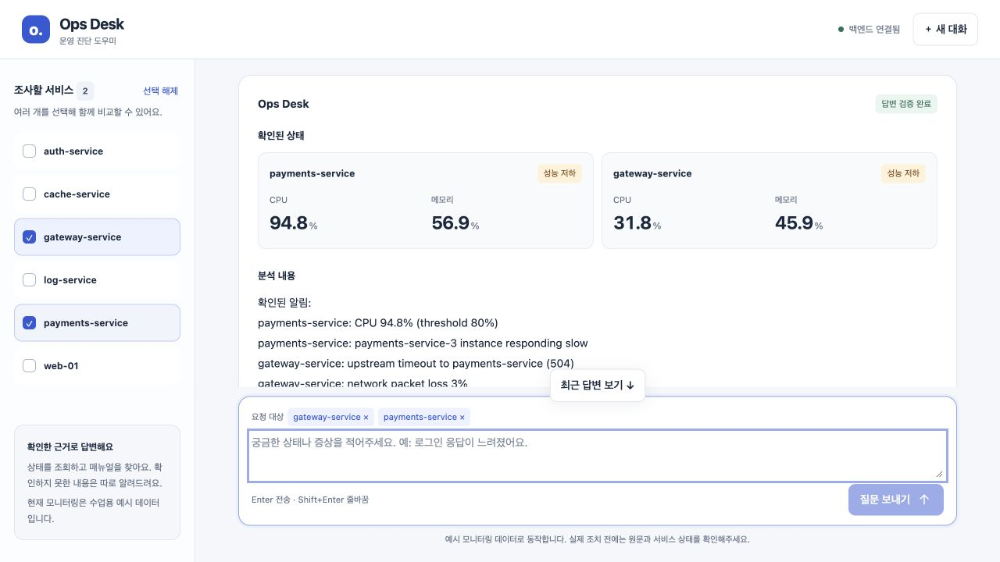

# 제출 전 통합 점검

점검일: 2026-10-21. 기준: 사용자가 제공한 `code_artifact.md`의 아키텍처·노드 체크리스트.
발표 자료는 제외했다. 요구사항 문서는 평가 기준으로 사용했으며 문서 안의 지시를 별도 작업 권한으로 취급하지 않았다.

## 이번 점검에서 수정한 문제

| 문제 | 재현 근거 | 수정 |
|---|---|---|
| 모델 추론 중 서버 응답 정지 | 실제 복합 진단 중 `/health` 3회 모두 2초 제한 시간 초과 | 동기 모델 호출을 작업 스레드에서 실행 |
| 모델 장애 시 API/SSE 안내 누락 | 연결 실패 주입 시 POST는 500 평문, SSE는 오류 이벤트 없이 종료 | JSON 오류와 `RequestFailed` SSE 이벤트, 질문 복구 흐름 연결 |
| 예시 관측값과 CPU 알림 불일치 | 화면의 CPU 89.3%와 원문 알림 CPU 91%가 충돌해 검증 실패 | 동일 조회의 CPU 값으로 예시 알림 구성, 80% 임계값 보존 |
| 필요한 자료 목록을 사실 주장으로 오판 | `확인할 자료: 서비스 상세 로그, 시계열 모니터링, 호출 추적`을 근거 없는 주장으로 판정 | 허용된 10개 자료명만 담긴 목록은 사실 검수에서 제외. 가설·자유 문장·운영 조치는 계속 검수 |

두 번째 복합 진단에서는 수치 불일치는 해소됐으나 자료 목록 오판이 발생했다. 이 중간 실패도 완료로 간주하지 않았다.
초안 형식 오류가 발생한 사례도 있어, 스키마 출력과 1회 재작성만으로 모든 진단의 성공을 보장하지 않는다.

## 검증 조건과 결과

- 별도 포트(backend 18100, frontend 18600), 임시 SQLite 사용. 실제 사용자 DB·환경 파일은 변경하지 않았다.
- Ollama fast `qwen3.5:2b`, quality `qwen3:8b`, 실제 MCP subprocess, 예시 모니터링의 무작위 변화 유지.
- 외부 LangSmith 전송과 유료 API 호출은 사용하지 않았다.
- 수정 후 진단 중 `/health`: 3/3 HTTP 200, 각각 0.0025 / 0.0005 / 0.0004초. 상태 요청만의 단일 관찰이며 모델 추론 속도 개선 수치가 아니다.
- 최종 자동 테스트: 87개 통과. 실제 MCP 연결, 조회 부분 실패, 코드 검증, HTTP/SSE 오류, 지연 중 이벤트 루프 응답, 예시 알림 일치 등을 포함한다.
- SDK의 구 필드명 접근에 대한 deprecation 경고가 있다. 테스트 실패는 아니며 SDK 호환 코드 정리 대상으로 남긴다.

| 사용자 흐름 | 확인 방식 | 판정 |
|---|---|---|
| 서비스 선택 → 상태 조회 | 실제 브라우저·Ollama·MCP | 상태·CPU·메모리 카드 확인 |
| Enter 전송 / Shift+Enter 줄바꿈 | 실제 브라우저 | 동작, 처리 중 중복 전송 버튼 비활성화 |
| 선택한 서비스에 “다시 확인해줘” | 실제 브라우저·Ollama·MCP | 선택 대상이 다음 요청에 포함되어 재조회 |
| 일반 대화 | 실제 frontend 프록시 → backend → Ollama SSE | FinalAnswer와 DONE 수신 |
| CPU 매뉴얼 검색 | 실제 frontend 프록시 → backend → Ollama/MCP SSE | lookup, 원문 대조 passed, FinalAnswer와 DONE 수신 |
| 미등록 서비스 / 대상 없는 진단 | 실제 frontend 프록시 → backend → Ollama SSE | 조사 전 대상 확인 안내, 정상 종료 |
| 복합 진단 최종 재검증 | 실제 브라우저·Ollama·MCP | passed, 재작성 없이 검증 1회, 두 서비스 상태·가설·원문 조치 카드 표시 |
| 일부 MCP 조회 실패 | 실제 MCP 기반 HTTP/SSE 회귀 테스트 + 해당 호출 실패 주입 | 성공 자료 유지, partial과 실패 사유 표시 |
| 모델 연결 실패·시간 초과·응답 오류 | HTTP/SSE 회귀 테스트 + 모델 경계 실패 주입 | 오류 안내, DONE, FinalAnswer 없음, 성공 대화 미저장 |
| 모델 장애 후 질문 복구 | 실제 브라우저 + 임시 서버의 모델 연결 실패 주입 | 요청 중단 안내, 질문 다시 불러오기, 입력 복구·전송 버튼 재활성화 |

후속 질문에서 이전 서비스명을 자동 추론하거나 이전 관측 시점과 비교하는 기능은 없다. 선택 서비스를 유지하는 UI 경로와 대화 이력 추론은 구분한다.

## 제출 체크리스트 대조

‘확인’은 아래 적힌 범위의 증거가 있다는 뜻이며 운영 환경 전체에 대한 보장이 아니다.

| 항목 | 상태 | 구현·확인 근거 또는 남은 범위 |
|---|---|---|
| ADR | 문서화 | [ADR](../doc/ADR.md)에 결정·대안·한계 기록 |
| FastAPI 통합 | 확인 | frontend 프록시, HTTP/SSE 테스트, 실제 브라우저 |
| MCP Server | 확인 | Tool·Resource·Prompt 호출, 실제 subprocess 테스트 |
| SSE Backend | 확인 | 노드 이벤트, 최종 답변, 실패 이벤트, DONE |
| SSE Frontend | 확인 | 결과 카드와 질문 복구. 모바일은 이전 점검 기록이며 이번에는 재검증하지 않음 |
| Multi-agent Streaming | 부분 | 역할별 LangGraph 노드 진행 이벤트. 독립 에이전트 간 토큰 스트리밍 구조는 아님. Research의 개별 이벤트는 노드 종료 후 전달 |
| Query Routing | 확인 | chat/lookup/incident, 미등록·미지정 대상 차단 |
| Dynamic Planning | 확인 | MCP Prompt → 모델 계획 → Gate, 실제 복합 흐름 |
| Validator | 확인·한계 있음 | 코드 대조 + LLM 판정, 최대 1회 재작성·실패 시 분석 비공개. 모델 오판 가능성은 남음 |
| Error Handling (10/11) | 부분 보완 | 조회 실패 격리 + HTTP/SSE 실패 안내. 시작 시 MCP 연결 복구·모든 외부 오류 자동 복구는 제공하지 않음 |
| Cost Optimization | 확인 | fast/quality 분리, 조회 정형화, 재조사·재작성 상한. usd는 비교용 추정이며 실제 청구액 아님 |
| Concurrent Execution | 확인 | 후속 수정에서 MCP 공통 lock 제거. 실제 stdio 3건의 실행 겹침·응답 대응·부분 실패·취소 격리 확인. [검증 기록](MCP-CONCURRENCY.md) |
| Stateless Session | 로컬 범위 확인 | thread_id + 파일 SQLite, 요청 상태는 그래프에 전달. 다중 머신 공유·분산 배포 검증 없음 |
| Modularization | 확인 | 모델·MCP·계획·근거·보고서·세션 모듈 분리 |
| Observability & Eval | 부분 | traceable 계측과 로컬 비교 결과 존재. LangSmith 외부 수신·Dataset 평가·Feedback 증거 없음 |
| Multi-agent 통합 | 역할 분리 구현 | Supervisor 그래프가 research/analysis 작업을 조정. 독립적인 다중 자율 에이전트 시스템이라고 주장하지 않음 |

노드 대조: `route`, 조건 분기, `chat_answer`, `plan`, `gate`, `research`, `replan_check`, `replan`, `analysis`, `write`, `validate`, `finalize`가 `agent/graph.py`에 있다. 정상 분기와 차단·부분 실패 분기는 테스트에서 확인한다. 재조사와 재작성은 매 요청에 항상 일어나는 단계가 아니다.

## 다음 작업의 범위

MCP 동시 실행은 후속 작업에서 완료했다. 기존 통합 점검의 87개에 동시 실행 회귀 3개를 추가해 전체 90개가 통과했다.

1. LangSmith는 최소 요청 한 건의 추적 트리와 고정 질문 비교 평가 결과를 확인한다. 외부 계정에 기록하지 않은 현재 상태를 완료로 표시하지 않는다.
2. 위 요건을 닫은 뒤 대표 시나리오만 재확인한다. 새 기능과 모델 교체 실험은 추가하지 않는다.

복합 진단의 단일 실행 성공을 일반적인 정확도로 해석하지 않는다. 최종 답변의 ‘CPU 과부하로 네트워크 손실 발생’은 추가 자료가 필요한 가설이며 인과관계가 입증된 결과가 아니다. 실제 장애 데이터 연결, 장기 성능·부하, 모든 표현의 의미 판정, 유료 OpenAI 호출은 이번 검증 범위 밖이다.

재현 명령:

```bash
LANGCHAIN_TRACING_V2=false LANGSMITH_TRACING=false .venv/bin/python3 -m unittest discover -s tests -q
```

실측 API 결과·코드 해시·최종 진단 결과는 [integration-check.json](integration-check.json)에 보관한다.


